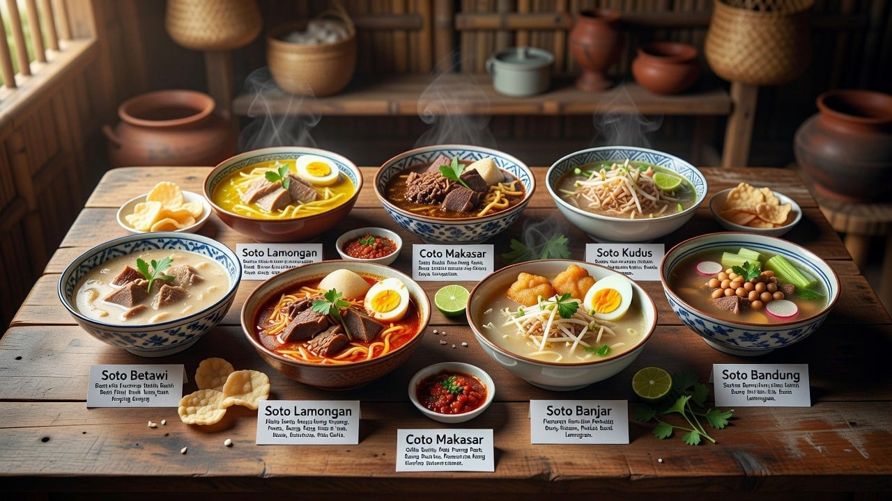
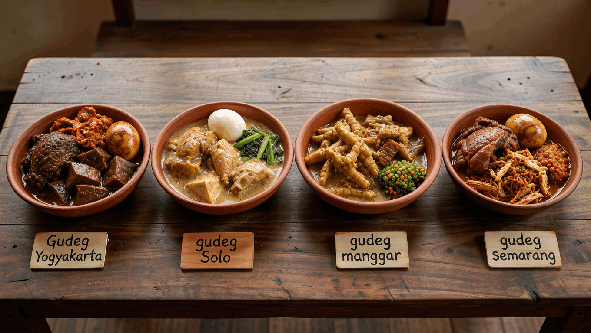

<!DOCTYPE html>
<html  >
<head>
  <!-- Site made with Mobirise Website Builder v6.1.12, https://mobirise.com -->
  <meta charset="UTF-8">
  <meta http-equiv="X-UA-Compatible" content="IE=edge">
  <meta name="generator" content="Mobirise v6.1.12, mobirise.com">
  <meta name="viewport" content="width=device-width, initial-scale=1, minimum-scale=1">
  <link rel="shortcut icon" href="assets/images/logo5.png" type="image/x-icon">
  <meta name="description" content="">
  
  
  <title>Halaman utama</title>
  <link rel="stylesheet" href="assets/web/assets/mobirise-icons2/mobirise2.css">
  <link rel="stylesheet" href="assets/bootstrap/css/bootstrap.min.css">
  <link rel="stylesheet" href="assets/parallax/jarallax.css">
  <link rel="stylesheet" href="assets/animatecss/animate.css">
  <link rel="stylesheet" href="assets/socicon/css/styles.css">
  <link rel="stylesheet" href="assets/theme/css/style.css">
  <link rel="preload" href="https://fonts.googleapis.com/css?family=Playfair+Display:400,500,600,700,800,900,400i,500i,600i,700i,800i,900i&display=swap" as="style" onload="this.onload=null;this.rel='stylesheet'">
  <noscript><link rel="stylesheet" href="https://fonts.googleapis.com/css?family=Playfair+Display:400,500,600,700,800,900,400i,500i,600i,700i,800i,900i&display=swap"></noscript>
  <link rel="preload" as="style" href="assets/mobirise/css/mbr-additional.css?v=QmQSrn"><link rel="stylesheet" href="assets/mobirise/css/mbr-additional.css?v=QmQSrn" type="text/css">

  
  
  
</head>
<body>
  
  <section data-bs-version="5.1" class="header16 cid-vvgNF2H9TL mbr-fullscreen mbr-parallax-background" id="header17-1i">
  
  
  

    

      

        <h1 class="mbr-section-title mbr-fonts-style mbr-white mb-4 display-1">
          <strong> SaMam</strong> <strong>Kuliner Etnik Indonesia</strong></h1>
        
        
SOTO - GUDEG - PAPEDA

        
<a class="btn btn-white-outline display-7" href="https://mobiri.se">&gt;&gt;&gt;</a>

      

    

  

</section>

<section data-bs-version="5.1" class="article07 cid-vvgOu9xpF6 mbr-parallax-background" id="article07-1k">
  

  
  

  

    

      

        

          <h3 class="card-title mbr-fonts-style mbr-white mt-3 mb-4 display-2"><strong>APA ITU KULINER ETNIK?</strong></h3>
          

            
            
            

              

                <h4 class="mbr-section-subtitle mbr-fonts-style mb-3 display-5">-&gt;</h4>
                

                  kuliner etnik dapat dipahami sebagai makanan khas yang menjadi bagian dari identitas dan tradisi suatu kelompok etnis. Biasanya, kuliner tersebut memiliki ciri khas dalam bahan, bumbu, teknik memasak, cara penyajian, serta nilai atau tradisi yang menyertainya.
                

              

            

            
          

          
<a class="btn btn-success display-7" href="https://www.menubly.com/blog/ethnic-menu/">MARI BERJELAJAH</a>

        

      

    

  

</section>

<section data-bs-version="5.1" class="slider3 cid-vvVHWb9d9C" id="slider03-1q">
    
    

        <ol class="carousel-indicators">
            <li data-slide-to="0" data-bs-slide-to="0" class="active" data-target="#vzelP2EdxO" data-bs-target="#vzelP2EdxO"></li>
            <li data-slide-to="1" data-bs-slide-to="1" data-target="#vzelP2EdxO" data-bs-target="#vzelP2EdxO"></li>
            <li data-slide-to="2" data-bs-slide-to="2" data-target="#vzelP2EdxO" data-bs-target="#vzelP2EdxO"></li>
        </ol>
        

            

                

                    
                    
                    

                        <h5 class="mbr-section-subtitle mbr-fonts-style mb-3 display-5"><strong>Variasi Soto di Indonesia</strong></h5>
                        
-&gt;

                        
<a class="btn btn-info display-7" href="page1.html">Lihat Detailnya</a>
     
                    

                

            

            

                

                    
                    
                    

                        <h5 class="mbr-section-subtitle mbr-fonts-style mb-3 display-5">
                            <strong>Variasi Gudeg di Indonesia</strong></h5>
                        
-&gt;

                        
<a class="btn btn-info display-7" href="page2.html">LIHAT DETAILNYA</a>
     
                    

                

            

            

                

                    
                    
                    

                        <h5 class="mbr-section-subtitle mbr-fonts-style mb-3 display-5">
                            <strong>Variasi Papeda di Indonesia</strong></h5>
                        
-&gt;

                        
<a class="btn btn-info display-7" href="page5.html">LIHAT DETAILNYA</a>
     
                    

                

            

        

        <a class="carousel-control carousel-control-prev" role="button" data-slide="prev" data-bs-slide="prev" href="#vzelP2EdxO">
            
            Previous
        </a>
        <a class="carousel-control carousel-control-next" role="button" data-slide="next" data-bs-slide="next" href="#vzelP2EdxO">
            
            Next
        </a>
    

</section>

<section data-bs-version="5.1" class="footer1 programm5 cid-tJS9NNcTLZ" once="footers" id="footer03-8">

        

    

    

        

            

                <ul class="header-menu">
                  
                  
                  
                  
                <li class="header-menu-item mbr-fonts-style display-5"><a href="page4.html" class="text-danger text-primary">About</a></li><li class="header-menu-item mbr-fonts-style display-5"><a href="page6.html" class="text-danger">Let Me Know You</a></li><li class="header-menu-item mbr-fonts-style display-5"><a href="page3.html" class="text-danger text-primary">Contacts</a></li><li class="header-menu-item mbr-fonts-style display-5"></li></ul>
              

            

                

                    

                        <a href="https://mobiri.se/" target="_blank">
                            
                        </a>
                    

                    

                        <a href="https://mobiri.se/" target="_blank">
                            
                        </a>
                    

                    

                        <a href="https://instagram.com/samuelps03?exln=dGl0MzhjY3Zmenl0 " target="_blank">
                            
                        </a>
                    

                    

                        <a href="https://www.tiktok.com/@samuelpratama02?_r=1&_t=ZS-9AW0wGTNFHZ" target="_blank">
                            
                        </a>
                    

                    

                        <a href="https://www.youtube.com/@samuelps7060" target="_blank">
                            
                        </a>
                    

                

            

            

                

                    © Copyright 2030 Mobirise - All Rights Reserved
                

            

        

    

</section><section class="display-7" style="padding: 0;align-items: center;justify-content: center;flex-wrap: wrap;    align-content: center;display: flex;position: relative;height: 4rem;">
&#8204;
<a style="z-index:1" href="https://mobirise.com/html-builder.html">HTML Creator</a></section>          
  
  
  <input name="animation" type="hidden">
  </body>
</html>
